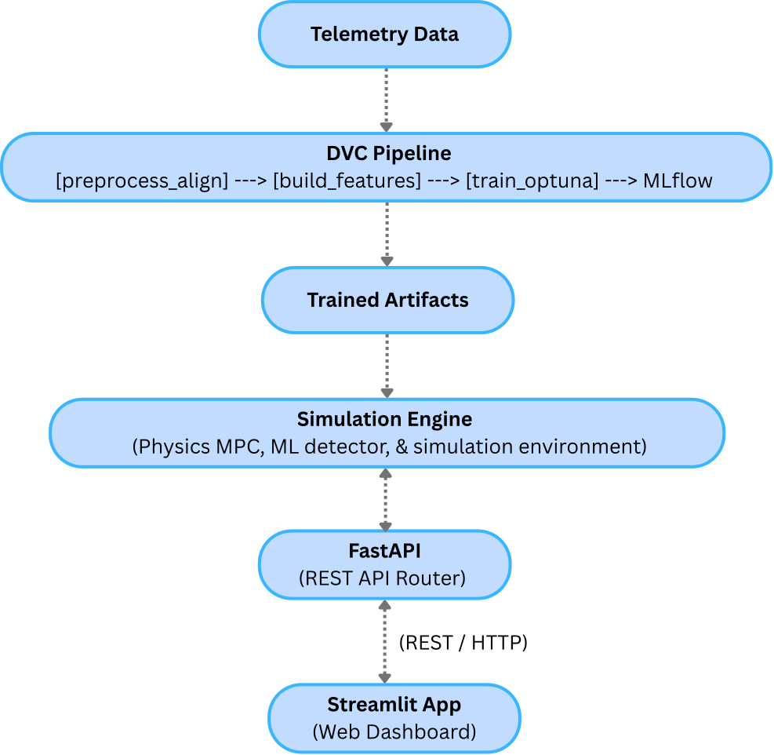
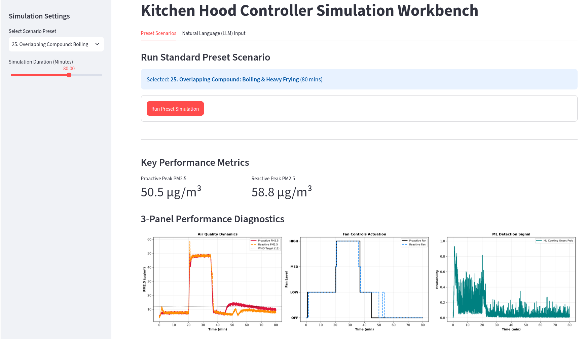
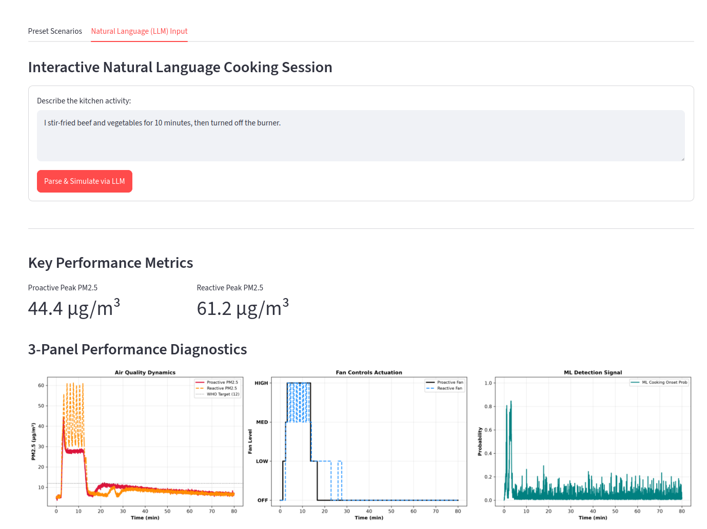

# Smart Range Hood Controller: ML Onset Detection & Physics-Based MPC Optimization

> **Project Scope & Intellectual Property Notice**
> This repository contains selected, IP-safe excerpts from the private, production-oriented project. Proprietary physics models, controller tuning, feature engineering, trained artifacts, raw telemetry, and detailed LLM prompts have been omitted or stubbed. The public showcase demonstrates the **system architecture, interfaces, and software engineering practices.**

---

## Architecture & Engineering Highlights

This repository serves as a showcase for production-ready MLOps practices, clean system boundaries, and robust API/frontend orchestration.

## System Architecture & Engineering Highlights

## System Architecture & Engineering Highlights

* **Structured LLM Orchestration & Deterministic Validation:** Integrates LangChain with Pydantic v2 (`ParsedScenarioParams`) to extract and validate structured parameters from natural-language prompts. Model-generated values undergo deterministic validation and reconciliation before reaching downstream simulation and control components.

* **Modular Architecture & Separation of Concerns:** Separates presentation (`frontend/`), API orchestration (`api/`), execution and simulation engines (`src/`, `simulations/`), and ML training pipelines (`pipelines/`). Clear component boundaries and interfaces reduce coupling and support independent testing and maintenance.

* **Reproducible MLOps & Experiment Tracking:** Uses DVC to version data and orchestrate a training pipeline covering alignment, feature engineering, and Optuna-based hyperparameter optimization. Pipeline dependencies and outputs are defined in `dvc.yaml` and `dvc.lock`, enabling reproducible execution with `uv run dvc repro`. MLflow tracks Optuna trials through nested runs, recording parameters and metrics, and logs model artifacts.

* **Containerization & Environment Management:** Uses dedicated Dockerfiles (`Dockerfile.api`, `Dockerfile.frontend`) and separate development and production Docker Compose configurations to standardize service setup across environments. Container images are built and published to GitHub Container Registry (GHCR) with commit-SHA tags.

* **Automated Quality Assurance & CI/CD:** GitHub Actions automates linting (Ruff), type checking (mypy), formatting, and Pytest execution. Unit tests (`tests/unit/`) verify individual components, while integration tests (`tests/integration/`) validate cross-component interactions and API behavior. A separate workflow builds and publishes API and frontend images to GHCR on pushes to `main`.

---

## System Overview

 


---


## Quick Start

### Prerequisites

* Python `3.12+`
* [`uv`](https://docs.astral.sh/uv/) package manager
* [Docker](https://www.docker.com/) & Docker Compose (for containerized execution)

### 1. Local Setup with `uv`

Clone the repository and sync dependencies:

```bash
git clone https://github.com/jocgaray/smart-range-hood-controller.git
cd smart-range-hood-controller

# Install dependencies into virtual environment
uv sync --all-extras --dev

```

### 2. Configure Environment Variables

Create your local environment configuration file from the template:

```bash
cp .env.example .env

```

### 3. Generate Sample Data & Reproduce Pipeline (DVC)

Since raw telemetry datasets are excluded via `.gitignore`, generate a synthetic sample dataset to test the pipeline locally:

```bash
# Create directory for sample data
mkdir -p data/sample

# Generate sample event annotations CSV
cat << 'EOF' > data/sample/annotations_sample.csv
ts,Label,end_ts
2026-10-04 18:05:00,Cooking_Searing,2026-10-04 18:20:00
2026-10-04 18:30:00,Cooking_Simmering,2026-10-04 18:55:00
2026-10-04 19:10:00,Cleaning_Steam,
EOF

# Generate synthetic telemetry covering the annotated timeframe (2 hours at 1 s)
uv run python -c "
import numpy as np
import pandas as pd

rng = np.random.default_rng(42)
n = 7200
df = pd.DataFrame({
    'timestamp': pd.date_range(start='2026-10-04 18:00:00', periods=n, freq='1s'),
    'pm2_5': rng.uniform(5.0, 150.0, n),
    'co2': rng.uniform(400.0, 1800.0, n),
    'voc': rng.uniform(0.1, 5.0, n),
    'temperature': rng.uniform(20.0, 28.0, n),
    'humidity': rng.uniform(35.0, 65.0, n),
})
df.to_parquet('data/sample/telemetry_sample.parquet')
print('Synthetic telemetry created (random values: for smoke-testing only).')
"

# Run the pipeline end-to-end via DVC
#(verifies the stages execute; metrics on random data are not meaningful)
uv run dvc repro

```

### 4. Run Application Locally

#### Option A: Docker Compose (Recommended)

Run both the FastAPI backend and Streamlit frontend in orchestrated containers:

```bash
docker compose up --build

```

Access the services:

* **Streamlit Dashboard:** `http://localhost:8501`
* **FastAPI Docs:** `http://localhost:8000/docs`

#### Option B: Standalone Services

**Start API:**

```bash
uv run uvicorn api.main:app --reload --port 8000

```

**Start Streamlit Frontend:**

```bash
uv run streamlit run frontend/app.py

```

---

## Project Structure

```text
.
├── .dvc/                   # DVC configuration and internal metadata
├── .github/
│   └── workflows/          # GitHub Actions (CI lint/test & CD image publishing)
├── api/                    # FastAPI backend code and endpoints
├── frontend/               # Streamlit application scripts and dashboard
├── pipelines/              # DVC ML pipeline stages (preprocessing & alignment, feature extraction, training + Optuna)
├── simulation/             # Physics-based MPC & telemetry scenario simulation
├── src/                    # Core domain logic, models, and shared utilities
├── tests/                  # Unit and integration test suite
│   ├── unit/               # Isolated domain logic tests
│   └── integration/        # End-to-end API and pipeline checks
├── .env.example            # Environment variable template
├── .gitignore              # Ignored files (raw datasets, cache, secrets)
├── Dockerfile.api          # Container definition for FastAPI backend
├── Dockerfile.frontend     # Container definition for Streamlit frontend
├── LICENSE.md              # Project license and IP terms
├── README.md               # Project documentation
├── docker-compose.yml      # Local development container orchestration
├── docker-compose.prod.yml # Production multi-container configuration
├── dvc.lock                # DVC pipeline stage state & hash tracking
├── dvc.yaml                # DVC stage pipeline definitions
├── pyproject.toml          # Project metadata & uv dependency configuration
└── uv.lock                 # Deterministic dependency lockfile

```

---

## Testing & Quality Assurance

Run the test suite, linter, and code formatter checks:

```bash
# Run tests with coverage threshold
uv run pytest tests/ --cov=src --cov-fail-under=35

# Lint code with Ruff
uv run ruff check .

# Check code formatting
uv run ruff format --check .

```

---

## CI/CD Automation

* **CI Pipeline (`ci.yml`):** Triggers on feature branches and pull requests to run Ruff linting, code formatting verification, Pytest suites, and Docker build checks.
* **CD Pipeline (`cd.yml`):** Pushes to `main` trigger automated container image builds for both API and Frontend services, publishing them directly to the GitHub Container Registry (GHCR).

---

## Screenshots of Production UI & Sample Scenario Results

The plots illustrate a performance comparison between proactive and reactive controllers, along with the predicted ML cooking onset probabilities.

**Overlapping Compound Cooking—Boiling and Heavy Frying**:  The simulation was generated using the preset scenario selector in the user interface. The superior performance of the proactive controller is clearly demonstrated, reducing peak pollutant exposure while simultaneously lowering energy usage.



**Stir-fry simulation instance (scenario generated using natural language)**: Here, a natural language cooking prompt was parsed into a structured simulation scenario via LLM output constraints. The superior performance of the proactive controller is clearly demonstrated, reducing peak pollutant exposure while simultaneously lowering energy usage and eliminating fan chatter.




---

## Intellectual Property & Licensing

Copyright (c) 2026 Jose Garay. All rights reserved.

This repository contains sanitized excerpts published strictly for portfolio and architectural showcase purposes. No license or permission is granted to copy, reproduce, modify, distribute, sublicense, or create derivative works from this code without explicit written consent from the owner. See `LICENSE.md` for full terms.

```

```